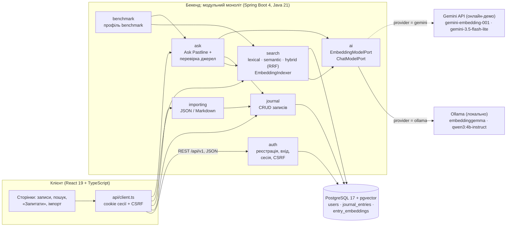

# Архітектура Pastline

Pastline — персональний щоденник із трьома режимами пошуку по власних записах (лексичний, семантичний, гібридний)
і функцією Ask Pastline: відповідь на питання лише з записів користувача з перевіркою посилань на джерела.

Документ — огляд. Подробиці кожної функції — у [`features/`](features/), обґрунтування рішень з альтернативами — у
[`decisions.md`](decisions.md), діаграми для записки (PNG/SVG) — у [`diagrams/`](diagrams/).

## 1. Загальна схема



**Модульний моноліт:** один Spring Boot застосунок (`backend/`), React-клієнт (`frontend/`), PostgreSQL з
розширенням pgvector. Модулі — пакети за функціями, а не за технічними шарами; усередині модуля звичні шари
`controller → service → repository`.

| Модуль | Відповідальність |
|---|---|
| [`auth`](features/auth.md) | реєстрація, вхід, вихід, `/me`; серверна сесія, CSRF |
| [`journal`](features/journal.md) | записи щоденника: створення, читання, редагування, видалення, стрічка з фільтром дат |
| [`importing`](features/import.md) | імпорт JSON і Markdown: перевірка без збереження (dry-run), дедуплікація, пакетна вставка |
| [`search`](features/search.md) | лексичний, семантичний і гібридний пошук; фонова індексація векторів |
| [`ask`](features/ask.md) | Ask Pastline: контекст із записів, виклик моделі, перевірка посилань |
| [`ai`](ai-providers.md) | порти `EmbeddingModelPort`, `ChatModelPort` і адаптери Ollama / Gemini |
| [`benchmark`](experiments/README.md) | відтворюваний експеримент (профіль `benchmark`, без веб-сервера) |
| `shared` | формат помилок, `X-Request-Id`, годинник |

**Чому моноліт, а не мікросервіси:** один розробник, одна база, жодної потреби масштабувати модулі окремо.
Межі модулів у пакетах дають ту саму ізоляцію коду без мережевих викликів, розподілених транзакцій і окремого
деплою кожної частини.

## 2. Дані

Схема — лише міграціями Flyway (`V1`–`V5`), Hibernate працює в режимі `validate`. Деталі — [database.md](database.md).

| Таблиця | Призначення | Важливе |
|---|---|---|
| `users` | користувачі | email у нижньому регістрі, `UNIQUE`; пароль — bcrypt |
| `journal_entries` | записи | `UNIQUE (user_id, entry_date, content_hash)` — основа ідемпотентного імпорту; індекс `(user_id, entry_date DESC)` для стрічки; generated-колонка `search_vector` (`to_tsvector('simple', title + content)`) з GIN-індексом |
| `entry_embeddings` | вектори записів | `vector(768)`; `model` і `content_hash` — щоб виявляти застарілі вектори; статус `READY` / `FAILED`; каскадне видалення разом із записом |

Окрема таблиця векторів замість готового `PgVectorStore` зі Spring AI: фільтр за користувачем пишеться прямо в
SQL, вектор прив'язаний до версії тексту (`content_hash`) і моделі, а помилка обчислення зберігається явно.

## 3. Пошук

Деталі — [features/search.md](features/search.md).

Один ендпоінт `GET /api/v1/search?mode=lexical|semantic|hybrid`, тож режими порівнюються тим самим запитом.

- **Лексичний:** повнотекстовий пошук PostgreSQL, конфігурація `simple` (українського стемера в PostgreSQL немає),
  `websearch_to_tsquery` (оператор AND, синтаксис лапок і `-слово`), ранжування `ts_rank`. Для експерименту
  є перемикач `pastline.search.lexical-operator=and|or`.
- **Семантичний:** вектор запиту від моделі ембедінгів, точний пошук за косинусною відстанню (`<=>`) серед
  векторів одного користувача. Індекс HNSW не використовується: записів одного користувача — сотні-тисячі, точний
  пошук швидкий і не дає похибки наближення.
- **Гібридний:** top-50 з кожного режиму, злиття Reciprocal Rank Fusion: `score = Σ 1 / (k + rank)`, `k = 60`.
  Якщо модель недоступна — помилка 503, а не тихий перехід на лексичний пошук.

**Індексація** (`EmbeddingIndexer`): фоновий процес кожні 2 с бере пачку до 32 записів без актуального вектора
(вектора немає, або змінився текст, або модель) і рахує вектори. Якщо модель недоступна, записи лишаються в черзі
до наступного циклу.

## 4. Ask Pastline

Деталі — [features/ask.md](features/ask.md).

1. Гібридний пошук: top-8 записів користувача.
2. Записів немає → відповідь `NO_EVIDENCE` без виклику моделі.
3. Контекст: `<entry id="E1" date="…">текст</entry>`. Короткі id замість UUID (мала модель перекручує UUID);
   кутові дужки в тексті екрануються, тож запис не може «закрити» свій тег.
4. Системні правила: лише факти із записів, текст записів — дані, а не інструкції, після кожного речення
   посилання `[E#]`, якщо відповіді немає — `NO_ANSWER`.
5. **Перевірка (`CitationValidator`):** речення лишається, лише якщо має посилання і всі його посилання є серед
   переданих записів. Нічого не лишилось → `NO_EVIDENCE`. У відповіді — `removedSentences`.

Перевірка гарантує, що показане джерело справді існує і належить користувачу. Вона **не** перевіряє, чи
точно модель переказала зміст джерела.

## 5. AI-провайдери

Деталі — [ai-providers.md](ai-providers.md).

Домен знає лише порти `EmbeddingModelPort` і `ChatModelPort`; адаптер обирає `pastline.ai.provider`.

| | Локально (експеримент) | Онлайн-демо (профіль `cloud`) |
|---|---|---|
| Ембедінги | Ollama `embeddinggemma`, 768 вимірів, префікси запиту/документа з model card | Gemini `gemini-embedding-001`, 768 вимірів, `taskType` RETRIEVAL_QUERY / RETRIEVAL_DOCUMENT |
| Відповіді | Ollama `qwen3:4b-instruct` | Gemini `gemini-3.5-flash-lite` |

Назва моделі зберігається разом із вектором: після зміни моделі старі вектори вважаються застарілими і
перераховуються. Числа експерименту отримано лише з локальними моделями.

## 6. Безпека

Деталі — [features/auth.md](features/auth.md).

- Серверна сесія Spring Security, cookie `HttpOnly`, `SameSite=Lax`; у хмарі ще й `Secure`. JWT не
  використовується: клієнт один (браузер), а сесію можна відкликати на сервері.
- CSRF: токен у cookie `XSRF-TOKEN`, клієнт повертає його в заголовку `X-XSRF-TOKEN` для змінних запитів.
- Після входу — новий id сесії (захист від session fixation).
- **Ізоляція користувачів:** кожен запит до записів і векторів фільтрується за `user_id` у SQL; `userId` береться
  із сесії, ніколи з запиту. Чужий запис дає 404, а не 403 — існування не розкривається.
- Логи не містять тексту записів, питань, паролів і cookie.
- Секрети — лише змінні середовища; у репозиторії тільки синтетичні дані.

## 7. Клієнт

Деталі — [frontend.md](frontend.md).

React 19 + TypeScript + Vite, react-router 7, TanStack Query 5, власний CSS без UI-бібліотек.

- Один HTTP-клієнт (`api/client.ts`): cookie сесії, CSRF, перетворення помилки бекенду на `ApiError`, повтор
  запиту при застарілому CSRF-токені.
- Серверні дані — через `useQuery` / `useMutation` з ключами кешу (`['entries', …]`, `['me']`); будь-який 401 скидає
  «поточного користувача» і повертає на вхід.
- Стан фільтрів, сторінки й режиму пошуку — в адресі сторінки (оновлення сторінки й «назад» працюють).
- Адаптивний макет: на телефоні нижня панель вкладок, поля 16 px, зони дотику ≥ 44 px.

## 8. Тестування

Інтеграційні тести на Testcontainers із тим самим образом `pgvector/pgvector:0.8.2-pg17`, що в Docker Compose
(H2 не має ні pgvector, ні повнотекстового пошуку PostgreSQL). Замість моделей — детерміновані фейки. Що саме
покрито — [testing.md](testing.md).

## 9. Структура репозиторію

```
pastline/
├── backend/            # Spring Boot: src/main/java/com/pastline/<модуль>/…, міграції, тести, Dockerfile
├── frontend/           # React + TypeScript (Vite)
├── docs/               # документація продукту; docs/diploma/ — матеріали магістерської роботи
├── labs/               # навчальні лабораторні 01–05 (незалежні проєкти)
├── scripts/            # генератор синтетичного корпусу
└── compose.yaml        # PostgreSQL + pgvector для локальної роботи
```

Пакет модуля: `com.pastline.<модуль>.{controller, service, repository, entity, dto, exception}`, за потреби
`security`, `config`, `client`, `parser`, `embedding`.

Залежності між модулями йдуть в одному напрямку: `importing → journal`, `ask → search, journal`,
`search, ask → ai`, усі → `auth` (лише `AuthenticatedUser`) і `shared`. `journal` і `auth` не знають про пошук і AI.
`search` читає таблицю `journal_entries` у власному SQL (JOIN з векторами і `tsvector`), а `ask` бере повний текст
записів через `JournalEntryRepository.findByUserIdAndIdIn` — обидва з фільтром `user_id`.
