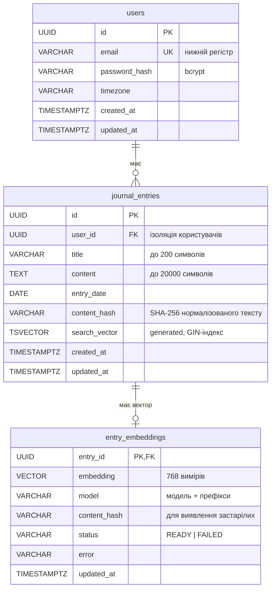

# База даних

PostgreSQL 17 з розширенням pgvector 0.8.2. Схема створюється **лише** міграціями Flyway
(`backend/src/main/resources/db/migration`); Hibernate працює в режимі `ddl-auto=validate` і тільки перевіряє, що
сутності відповідають таблицям.

## Схема



Зображення для записки: [`diagrams/er`](diagrams/er.png).

## Таблиці

### `users`

| Колонка | Тип | Примітка |
|---|---|---|
| `id` | `UUID` PK | генерується в Java |
| `email` | `VARCHAR(320)` | зберігається в нижньому регістрі |
| `password_hash` | `VARCHAR(100)` | bcrypt з префіксом `{bcrypt}` |
| `timezone` | `VARCHAR(64)` | IANA, напр. `Europe/Kyiv` |
| `created_at`, `updated_at` | `TIMESTAMPTZ` | |

### `journal_entries`

| Колонка | Тип | Примітка |
|---|---|---|
| `id` | `UUID` PK | генерується в Java |
| `user_id` | `UUID` FK → `users` | `ON DELETE CASCADE`; є в умові кожного запиту |
| `title` | `VARCHAR(200)` | може бути `NULL` |
| `content` | `TEXT` | до 20 000 символів (перевіряє API) |
| `entry_date` | `DATE` | день запису, без часу й часового поясу |
| `content_hash` | `VARCHAR(64)` | SHA-256 нормалізованого тексту (hex) |
| `search_vector` | `tsvector` | `GENERATED ALWAYS AS (to_tsvector('simple', coalesce(title, '') \|\| ' ' \|\| content)) STORED` |
| `created_at`, `updated_at` | `TIMESTAMPTZ` | |

### `entry_embeddings`

| Колонка | Тип | Примітка |
|---|---|---|
| `entry_id` | `UUID` PK, FK → `journal_entries` | один вектор на запис; `ON DELETE CASCADE` |
| `embedding` | `vector(768)` | `NULL` для `FAILED` |
| `model` | `VARCHAR(100)` | назва моделі з варіантом (`embeddinggemma+prompts`, `gemini-embedding-001@768`) |
| `content_hash` | `VARCHAR(64)` | хеш тексту, з якого пораховано вектор |
| `status` | `VARCHAR(16)` | `READY` або `FAILED` |
| `error` | `VARCHAR(200)` | тип і повідомлення помилки, без тексту запису |
| `updated_at` | `TIMESTAMPTZ` | |

## Обмеження та індекси

| Назва | Що гарантує / прискорює |
|---|---|
| `users_email_unique` — `UNIQUE (email)` | один акаунт на email; нечутливість до регістру, бо email уже в нижньому регістрі |
| `journal_entries_dedup_unique` — `UNIQUE (user_id, entry_date, content_hash)` | той самий текст за ту саму дату лише раз; основа ідемпотентного імпорту |
| `journal_entries_user_date_idx` — `(user_id, entry_date DESC)` | стрічка користувача й фільтр дат |
| `journal_entries_search_idx` — `GIN (search_vector)` | лексичний пошук `@@` |
| `entry_embeddings_status_check` | `status IN ('READY', 'FAILED')` |
| `entry_embeddings_ready_has_vector` | `READY` завжди має вектор |

Індексу для векторів (HNSW / IVFFlat) немає свідомо: пошук точний, серед векторів одного користувача
([рішення 13](decisions.md#d13)).

## Коли вектор актуальний

Вектор використовується пошуком, лише якщо `status = 'READY'`, `x.model` = поточна модель і
`x.content_hash = journal_entries.content_hash`. Окремого статусу `PENDING` немає: «потребує перерахунку» — це
відсутній рядок або розбіжність хешу чи моделі. Так стан не може розійтися з даними: редагування тексту саме собою
робить вектор застарілим.

## Міграції

| Файл | Що робить |
|---|---|
| `V1__init.sql` | `CREATE EXTENSION vector` |
| `V2__users.sql` | таблиця `users` |
| `V3__journal_entries.sql` | таблиця `journal_entries`, ключ дедуплікації, індекс стрічки |
| `V4__search_vector.sql` | generated-колонка `search_vector` + GIN |
| `V5__entry_embeddings.sql` | таблиця `entry_embeddings` |

Правила:

- Застосована міграція не змінюється ніколи: Flyway звіряє контрольні суми і зупинить запуск. Зміна схеми — новий
  файл `V6__…sql`.
- Тести застосовують ті самі міграції до чистої БД у Testcontainers, тож помилку в міграції видно до коміту.

## Доступ до даних

| Що | Як | Чому |
|---|---|---|
| Користувачі, записи (CRUD) | Spring Data JPA | звичайні операції з сутностями |
| Лексичний пошук, вектори | `NamedParameterJdbcTemplate`, native SQL | `tsquery`, `<=>`, `ON CONFLICT` і результат «рядок + ранг» простіше й прозоріше в SQL, ніж через JPA |

Вектор передається в SQL як текстовий літерал `'[0.1,0.2,…]'` з `CAST(:query AS vector)` — без окремої бібліотеки
типів pgvector для JDBC.

## Локальна БД

`compose.yaml` піднімає `pgvector/pgvector:0.8.2-pg17` на порту `5434` (змінна `PASTLINE_DB_PORT`), база, логін і
пароль — `pastline`. Дані — у Docker-томі `pastline-pgdata`.

```powershell
docker compose up -d
docker compose exec postgres psql -U pastline -d pastline     # консоль SQL
docker compose down -v                                         # видалити разом із даними
```
