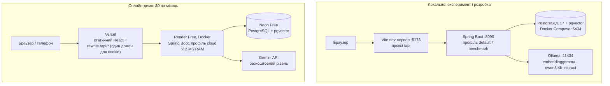

# Деплой онлайн-демо

Онлайн-демо: **https://pastline.vercel.app** (бекенд — `https://pastline-api.onrender.com`). Вартість — $0 на
місяць: усе на безкоштовних планах. Демо призначене для показу; числа експерименту отримано локально
([рішення 25](decisions.md#d25)).



Зображення для записки: [`diagrams/deployment`](diagrams/deployment.png).

## Складники

| Частина | Сервіс | Налаштування |
|---|---|---|
| Клієнт | Vercel | Root Directory `frontend`, збірка `npm run build`, вихід `dist`; `frontend/vercel.json` пересилає `/api/*` на бекенд |
| Бекенд | Render, Free Web Service, Docker | Root Directory `backend`, `backend/Dockerfile`, Health Check Path `/actuator/health` |
| БД | Neon, Free | PostgreSQL з pgvector; **пряме** підключення (хост без `-pooler`), `sslmode=require` |
| AI | Gemini API | ключ з Google AI Studio, безкоштовний рівень |

### Чому rewrite на Vercel, а не CORS

Браузер бачить один сайт `pastline.vercel.app`: запити `/api/*` Vercel пересилає на Render. Cookie сесії — first-party,
`SameSite=Lax` працює, CSRF-cookie читається тим самим JavaScript, а CORS на бекенді не потрібен. Без rewrite
клієнт і бекенд були б різними сайтами, і cookie сесії стала б сторонньою (third-party), яку браузери блокують.

### Чому пряме підключення до Neon

Хост з `-pooler` веде через PgBouncer у режимі transaction pooling, який не підтримує частину сесійних можливостей
PostgreSQL; Neon радить для міграцій (Flyway) пряме підключення. Пулу Hikari на 4 з'єднання для демо достатньо.

## Docker-образ бекенду (`backend/Dockerfile`)

- Дві стадії: `eclipse-temurin:21-jdk` збирає jar через Maven Wrapper (`-DskipTests` — у Render немає Docker для
  Testcontainers; тести проходять локально перед комітом), `eclipse-temurin:21-jre` запускає.
- Процес працює від непривілейованого користувача `pastline` (uid 10001).
- 512 МБ RAM на Free: `-XX:MaxRAMPercentage=70 -XX:+UseSerialGC -Xss512k -XX:+ExitOnOutOfMemoryError`.
- `SPRING_PROFILES_ACTIVE=cloud` задано в образі.

Перевірити локально:

```powershell
docker build -t pastline-api backend
```

## Змінні середовища Render

| Змінна | Значення |
|---|---|
| `SPRING_DATASOURCE_URL` | `jdbc:postgresql://<host>/neondb?sslmode=require&reWriteBatchedInserts=true` |
| `SPRING_DATASOURCE_USERNAME` | з панелі Neon |
| `SPRING_DATASOURCE_PASSWORD` | з панелі Neon — **секрет** |
| `GEMINI_API_KEY` | з Google AI Studio — **секрет** |
| `GEMINI_CHAT_MODEL`, `GEMINI_EMBEDDING_MODEL` | необов'язково; за замовчуванням `gemini-3.5-flash-lite`, `gemini-embedding-001` |

Секрети задаються лише в панелі Render. Їх немає в Git, у `.env`, у логах і в чатах. Якщо секрет потрапив
кудись іще — його треба змінити в Neon / AI Studio і оновити в Render.

## Що відрізняється в профілі `cloud`

| | Локально | `cloud` |
|---|---|---|
| Моделі | Ollama: `embeddinggemma`, `qwen3:4b-instruct` | Gemini: `gemini-embedding-001`, `gemini-3.5-flash-lite` |
| Cookie сесії | `HttpOnly`, `SameSite=Lax` | + `Secure` |
| Адреса клієнта | пряма | з `X-Forwarded-*` (`server.forward-headers-strategy=framework`) |
| Пул БД | Hikari за замовчуванням | 4 з'єднання, мінімум 1 |
| Індексатор | пачка раз на 2 с | раз на 3 с (ліміт Gemini для ембедінгів) |

## Оновлення

1. `git push` у `main`.
2. Vercel і Render збирають нову версію автоматично (auto-deploy з GitHub увімкнено за замовчуванням в обох).
3. Перевірка: `https://pastline-api.onrender.com/actuator/health` → `{"status":"UP"}`, потім вхід і пошук на
   `https://pastline.vercel.app`.

Після зміни моделі ембедінгів старі вектори автоматично стають застарілими і перераховуються фоновим індексатором.

## Обмеження безкоштовних планів

- Render засинає після 15 хв без запитів: перший запит після цього чекає ~1 хв, а сесії губляться (вони в пам'яті
  процесу).
- Ліміти безкоштовного рівня Gemini: при перевищенні — 503 `EMBEDDING_UNAVAILABLE` / `AI_UNAVAILABLE`.
- Безкоштовний рівень Gemini може використовувати запити для покращення продуктів Google: в онлайн-демо лише
  синтетичні записи, без справжніх.

## Що далі (поза дипломом)

Для продукту з підпискою потрібні: платний план без засинання, сесії в Redis або БД (Spring Session JDBC), платний
рівень AI-провайдера без використання даних для навчання, резервні копії БД і моніторинг. Переносити все на AWS
варто після перевірки попиту, а не до неї.
