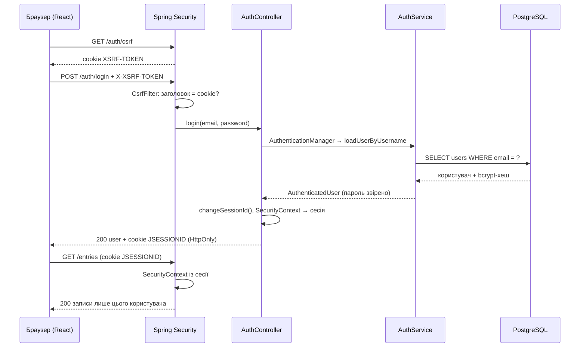

# Автентифікація

Реєстрація, вхід, вихід і «хто я». Сесія зберігається на сервері, браузер тримає лише її id в cookie `HttpOnly`.
Змінні запити захищені CSRF-токеном.

Код: `backend/.../auth/` (`AuthController`, `AuthService`, `security/SecurityConfig`, `security/AuthenticatedUser`),
клієнт: `frontend/src/api/client.ts`, `frontend/src/auth/useAuth.ts`.

## Ендпоінти

| Метод і шлях | Доступ | Тіло | Відповідь |
|---|---|---|---|
| `GET /api/v1/auth/csrf` | публічний | — | 200 `{headerName, token}` + cookie `XSRF-TOKEN` |
| `POST /api/v1/auth/register` | публічний | `{email, password, timezone?}` | 201 `{id, email, timezone}` |
| `POST /api/v1/auth/login` | публічний | `{email, password}` | 200 `{id, email, timezone}` + cookie `JSESSIONID` |
| `POST /api/v1/auth/logout` | сесія | — | 204 |
| `GET /api/v1/me` | сесія | — | 200 `{id, email, timezone}` |

Правила полів: `email` — валідний, до 320 символів; `password` — 8–128 символів; `timezone` — IANA-ідентифікатор
(`Europe/Kyiv`), якщо не передано, береться `Europe/Kyiv`.

```http
POST /api/v1/auth/login
Content-Type: application/json
X-XSRF-TOKEN: 3f1c…

{ "email": "anna@example.com", "password": "correct-horse" }
```

```json
{ "id": "0b7e…", "email": "anna@example.com", "timezone": "Europe/Kyiv" }
```

## Помилки

| HTTP | `code` | Коли |
|---|---|---|
| 400 | `VALIDATION_ERROR` | некоректний email, короткий пароль, невідомий часовий пояс |
| 401 | `INVALID_CREDENTIALS` | неправильний email **або** пароль (відповідь однакова, щоб не розкривати, чи існує email) |
| 401 | `UNAUTHORIZED` | запит без сесії до захищеного ендпоінта |
| 403 | `CSRF_INVALID` | змінний запит без заголовка `X-XSRF-TOKEN` або з застарілим токеном |
| 409 | `EMAIL_TAKEN` | email уже зареєстрований |

## Flow: вхід і перший захищений запит



## Як це працює

### 1. Ланцюжок фільтрів (`SecurityConfig`)

- Публічні лише `/actuator/health`, `/api/v1/auth/csrf`, `/register`, `/login`; решта — `authenticated()`.
- `formLogin`, `httpBasic` і стандартний `logout` вимкнено: API повертає JSON, а не HTML-сторінки й редиректи.
- Без сесії → 401 `UNAUTHORIZED`, CSRF-помилка → 403 `CSRF_INVALID`, інша заборона → 403 `ACCESS_DENIED`. Ці
  відповіді пишуться в тому самому форматі `ErrorResponse`, що й решта помилок API.
- Бін ланцюжка створюється лише у веб-застосунку (`@ConditionalOnWebApplication`): профіль `benchmark` працює без
  веб-сервера.

### 2. CSRF

`CookieCsrfTokenRepository.withHttpOnlyFalse()` кладе токен у cookie `XSRF-TOKEN`, яку JavaScript **може**
прочитати. Клієнт копіює значення в заголовок `X-XSRF-TOKEN`. Чужий сайт не може прочитати cookie іншого домену,
тож не підробить і заголовок — це схема «double submit cookie».

`CsrfTokenRequestAttributeHandler` вимикає маскування токена (Spring Security 6+ за замовчуванням маскує його
для захисту від BREACH), щоб значення з cookie можна було передати як є.

### 3. Реєстрація (`AuthService.register`)

1. Email нормалізується: `strip()` + `toLowerCase(Locale.ROOT)`. Тому `UNIQUE (email)` у БД дає нечутливість до
   регістру без функціонального індексу.
2. Часовий пояс перевіряється через `ZoneId.of` → інакше `InvalidTimezoneException` (400).
3. Пароль хешується `DelegatingPasswordEncoder` (bcrypt, хеш має префікс `{bcrypt}`).

Реєстрація **не** створює сесію. Клієнт (`useRegister`) одразу після неї викликає вхід тими самими даними.

### 4. Вхід (`AuthController.login`)

1. `AuthenticationManager` → `DaoAuthenticationProvider` → `AuthService.loadUserByUsername` → звірка bcrypt.
2. Невідомий email і неправильний пароль дають той самий `BadCredentialsException` → 401 `INVALID_CREDENTIALS`.
3. `changeSessionId()` — захист від **session fixation**: id сесії, який міг знати зловмисник до входу, перестає
   діяти.
4. `SecurityContext` зберігається в сесії через `HttpSessionSecurityContextRepository`.

Після входу CSRF-токен теж змінюється. Клієнт обробляє це сам: на `403 CSRF_INVALID` бере свіжий токен і
повторює запит один раз (`client.ts`, функція `send`).

### 5. Принципал (`AuthenticatedUser`)

Власна реалізація `UserDetails`: `id`, `email`, хеш пароля. `eraseCredentials()` обнуляє хеш після автентифікації,
тож у сесії він не зберігається. Контролери отримують `@AuthenticationPrincipal AuthenticatedUser` і беруть
`user.id()` — це **єдине** джерело власника для записів, пошуку й Ask.

### 6. Клієнт

- `useMe()` — запит `GET /me`, кеш TanStack Query з ключем `['me']`: `User`, `null` (401 = сесії немає) або
  `undefined` (ще завантажується).
- `AppLayout` без сесії перенаправляє на `/login`; `PublicOnly` з сесією — на головну.
- Будь-який 401 від будь-якого запиту ставить `['me'] = null` (`main.tsx`), і користувач опиняється на вході.
- Вихід очищає весь кеш, щоб дані попереднього користувача не лишились у пам'яті вкладки.

## Налаштування

| Властивість | Значення | Навіщо |
|---|---|---|
| `server.servlet.session.cookie.http-only` | `true` | JavaScript не бачить cookie сесії (XSS не викраде її) |
| `server.servlet.session.cookie.same-site` | `lax` | cookie не йде з POST-запитами з чужих сайтів |
| `server.servlet.session.cookie.secure` | `true` у профілі `cloud` | cookie лише через HTTPS |

## Обмеження

- Сесія живе в пам'яті процесу: перезапуск бекенду (наприклад, «засинання» Render) розлогінює всіх.
- Немає скидання пароля, підтвердження email і обмеження частоти спроб входу.
- JWT для мобільного клієнта — після диплома ([рішення 9](../decisions.md#d09)).
