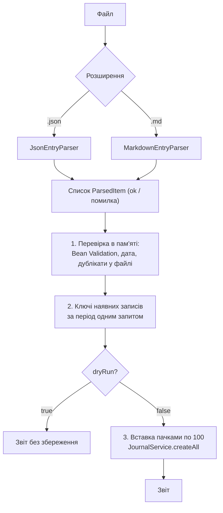

# Імпорт записів

Завантаження багатьох записів з файлу JSON або Markdown. Спершу перевірка без збереження, потім імпорт.
Повторний імпорт того самого файлу безпечний: дублікати пропускаються.

Код: `backend/.../importing/` (`ImportController`, `ImportService`, `parser/JsonEntryParser`,
`parser/MarkdownEntryParser`, `parser/ImportFormat`), клієнт: `frontend/src/pages/ImportPage.tsx`.

## Ендпоінт

`POST /api/v1/import?dryRun=true|false`, `multipart/form-data`, поле `file`.

| Параметр | За замовчуванням | Що робить |
|---|---|---|
| `dryRun` | `true` | `true` — лише розбір, перевірка і підрахунок; `false` — збереження |

Обмеження: файл до 5 МБ (`spring.servlet.multipart.max-file-size`), до 5000 записів, у звіті до 100 перших
помилок. Формат визначається за розширенням: `.json`, `.md`, `.markdown`.

### Формат JSON

Масив об'єктів. Зайві поля (наприклад, `id` чи `topic` у синтетичному корпусі) ігноруються.

```json
[
  { "title": "Пробіжка", "content": "Пробіг 5 км у парку.", "entryDate": "2026-03-14" },
  { "content": "Запис без заголовка", "entryDate": "2026-03-15" }
]
```

### Формат Markdown

Кожен запис починається із заголовка другого рівня з датою; далі необов'язковий заголовок запису. Заголовки інших
рівнів (`#`, `###`) лишаються частиною тексту.

```markdown
## 2026-03-14 Пробіжка
Пробіг 5 км у парку.

## 2026-03-15
Запис без заголовка.
```

### Відповідь

```json
{
  "dryRun": true,
  "total": 120,
  "created": 117,
  "duplicates": 2,
  "failed": 1,
  "firstDate": "2025-01-03",
  "lastDate": "2026-03-15",
  "errors": [ { "index": 41, "message": "entryDate: дата не може бути в майбутньому" } ]
}
```

`index` — позиція запису у файлі з нуля. При `dryRun=true` поле `created` означає «було б створено».

## Помилки

Помилки окремих записів потрапляють у `errors` і не зупиняють імпорт. Відмова для всього файлу:

| HTTP | `code` | Коли |
|---|---|---|
| 400 | `IMPORT_UNSUPPORTED_FORMAT` | розширення не `.json` / `.md` / `.markdown` |
| 400 | `IMPORT_INVALID_FILE` | порожній файл, не JSON, JSON не масив, понад 5000 записів |
| 413 | `PAYLOAD_TOO_LARGE` | файл більший за 5 МБ |

## Flow



## Як це працює

### 1. Розбір: помилка одного запису не ламає файл

Парсери повертають `List<ParsedItem>`: кожен елемент або `ok(EntryRequest)`, або `failed(повідомлення)`.

- `JsonEntryParser` читає дерево (`readTree`) і перетворює кожен вузол окремо. Дата читається як рядок, щоб
  неправильний формат дати став помилкою конкретного запису, а не винятком Jackson для всього файлу.
- `MarkdownEntryParser` йде рядками: `## ` відкриває новий запис, решта рядків — його текст. Текст перед першим
  заголовком не губиться мовчки: він стає окремою помилкою «не імпортовано».
- Текстовий файл декодується як UTF-8, BOM на початку (його додають деякі редактори Windows) прибирається.

### 2. Крок 1: перевірка в пам'яті (`ImportService.importFile`)

Кожен запис проходить ті самі правила, що й `POST /entries`: анотації `EntryRequest` через `Validator` плюс
заборона дати в майбутньому. Ключ дедуплікації — `дата|sha256(нормалізований текст)`, той самий, що в БД.
`LinkedHashMap.putIfAbsent` відсіює дублікати всередині файлу й зберігає порядок.

### 3. Крок 2: дублікати з базою — одним запитом

Замість запиту на кожен запис сервіс бере ключі всіх наявних записів користувача за період
`[firstDate, lastDate]` файлу (`JournalService.existingKeys`) і віднімає їх від кандидатів.

### 4. Крок 3: вставка пачками

Без `dryRun` кандидати вставляються пачками по 100 (`JournalService.createAll`, одна транзакція на пачку).
Hibernate групує INSERT (`hibernate.jdbc.batch_size=100`), драйвер PostgreSQL з `reWriteBatchedInserts=true` зливає
їх у багаторядковий INSERT.

Якщо паралельний імпорт встиг вставити частину тієї самої пачки, обмеження `UNIQUE` дасть
`DataIntegrityViolationException`. Тоді ця пачка повторюється по одному запису, і конфлікти рахуються як
дублікати.

Імпорт не має однієї транзакції на весь файл: уже вставлені пачки лишаються, а повторний запуск пропустить їх як
дублікати. Це простіше й надійніше за відкат тисяч записів.

### 5. Після імпорту

Вектори для нових записів рахує фоновий індексатор (пачки по 32). Імпорт не чекає на модель ембедінгів і не
блокує HTTP-запит; поки вектори рахуються, `pendingCount` у відповіді пошуку показує, скільки записів ще не
проіндексовано.

### 6. Клієнт

Сторінка «Імпорт» робить два запити: спершу `dryRun=true` і показує звіт, потім за кнопкою — `dryRun=false`.
Файл відправляється як `FormData`; `Content-Type` з межею multipart браузер ставить сам.

## Обмеження

- Немає імпорту з інших застосунків (Day One, Notion): лише два власні формати.
- Розбір іде повністю в пам'яті — тому і межа 5 МБ / 5000 записів.
