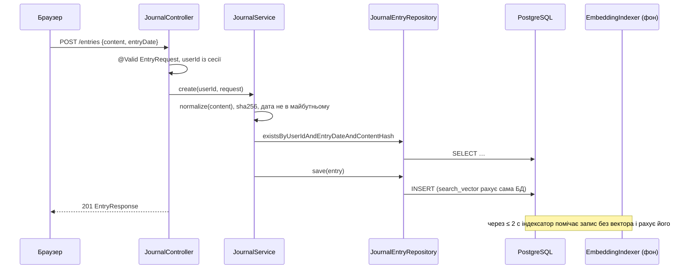

# Записи щоденника

Створення, читання, редагування й видалення записів, стрічка з фільтром дат. Кожен запис належить одному
користувачу, і жоден запит не бачить чужих записів.

Код: `backend/.../journal/` (`JournalController`, `JournalService`, `JournalEntryRepository`, `entity/JournalEntry`),
клієнт: `frontend/src/entries/useEntries.ts`, `pages/EntriesPage.tsx`, `pages/EntryEditorPage.tsx`.

## Ендпоінти

| Метод і шлях | Тіло / параметри | Відповідь |
|---|---|---|
| `POST /api/v1/entries` | `{title?, content, entryDate}` | 201 запис |
| `GET /api/v1/entries` | `from?`, `to?` (yyyy-MM-dd), `page` (від 0, за замовч. 0), `size` (1–100, за замовч. 20) | 200 сторінка |
| `GET /api/v1/entries/{id}` | — | 200 запис |
| `PUT /api/v1/entries/{id}` | `{title?, content, entryDate}` | 200 запис |
| `DELETE /api/v1/entries/{id}` | — | 204 |

Правила полів: `title` — до 200 символів, порожній перетворюється на `null`; `content` — обов'язковий, до 20 000
символів; `entryDate` — обов'язкова, не пізніше за «сьогодні» в будь-якому часовому поясі (UTC+14).

```json
{
  "id": "5d1a…",
  "title": "Пробіжка",
  "content": "Пробіг 5 км у парку біля дому.",
  "entryDate": "2026-03-14",
  "createdAt": "2026-03-14T18:02:11Z",
  "updatedAt": "2026-03-14T18:02:11Z"
}
```

Сторінка стрічки: `{items, page, size, totalItems, totalPages}`, записи від новіших до старіших
(`entry_date DESC, created_at DESC, id DESC`).

## Помилки

| HTTP | `code` | Коли |
|---|---|---|
| 400 | `VALIDATION_ERROR` | порожній текст, задовгий заголовок, дата в майбутньому, `from > to`, `size` поза 1–100 |
| 404 | `ENTRY_NOT_FOUND` | запису немає **або він чужий** |
| 409 | `ENTRY_DUPLICATE` | у користувача вже є запис з тим самим текстом за ту саму дату |

## Flow: створення запису



## Як це працює

### 1. Власник — лише із сесії

Контролер бере `@AuthenticationPrincipal AuthenticatedUser user` і передає `user.id()` у сервіс. У тілі запиту
поля `userId` немає взагалі. Кожен метод репозиторію має `userId` в умові: `findByIdAndUserId`,
`findByUserIdAndEntryDateBetween`, `findByUserIdAndIdIn`. Тому чужий запис неможливо навіть прочитати, а відповідь
на нього — 404, а не 403: клієнт не дізнається, що такий id існує.

`JournalEntry` зберігає `userId` як `UUID`, без `@ManyToOne User`. Модулю `journal` не потрібна сутність
користувача, а запити не тягнуть зайвий JOIN.

### 2. Дедуплікація

`JournalService.normalize` уніфікує переноси рядків (`\r\n` → `\n`) і прибирає пробіли по краях. Від цього тексту
рахується SHA-256 (`content_hash`). Обмеження `UNIQUE (user_id, entry_date, content_hash)` у БД гарантує: той самий
текст за ту саму дату в одного користувача лише раз. Сервіс перевіряє це заздалегідь, щоб повернути зрозумілий
409 `ENTRY_DUPLICATE`; якщо паралельний запит встиг раніше, спрацює обмеження БД (409 `CONFLICT`).

На цьому ключі тримається й повторний імпорт того самого файлу (див. [імпорт](import.md)).

### 3. Дата «не в майбутньому»

Користувач може бути в будь-якому часовому поясі, а сервер — в UTC. Тому «сьогодні» береться в найпізнішому поясі
на Землі, UTC+14: дата не пізніша за неї коректна для кожного.

### 4. Стрічка з фільтром

`from` і `to` необов'язкові. Замість `(:from IS NULL OR entry_date >= :from)` сервіс підставляє межі
`0001-01-01` / `9999-12-31`: PostgreSQL не може визначити тип `null`-параметра в такому виразі. Запит
`findByUserIdAndEntryDateBetween` використовує індекс `(user_id, entry_date DESC)`.

### 5. Редагування і вектори

`update` змінює текст і `content_hash`. Вектор запису в `entry_embeddings` має старий хеш, тож семантичний пошук
перестає його використовувати, а фоновий індексатор перераховує (див. [пошук](search.md#4-індексація)). Видалення
запису каскадно видаляє і його вектор (`ON DELETE CASCADE`).

### 6. `Persistable`

`JournalEntry` отримує UUID у конструкторі, тобто до збереження. Spring Data за замовчуванням вважає сутність з
непорожнім id наявною і робить `merge` (зайвий `SELECT` перед кожним `INSERT`). `JournalEntry implements
Persistable` з прапорцем `isNew` каже Spring Data, що запис новий, і `save` одразу робить `persist`. Для імпорту
сотень записів це помітна різниця.

### 7. Клієнт

- Ключі кешу починаються з `'entries'` (`entryKeys` у `useEntries.ts`). Після створення, зміни чи видалення
  скидається весь префікс, і всі списки та картки перезавантажуються.
- Фільтр дат і номер сторінки зберігаються в адресі (`?from=&to=&page=`), тож оновлення сторінки й «назад» у
  браузері працюють без додаткового коду.
- Редактор для `/entries/new` і `/entries/:id` один. Форма отримує `key` за id запису, тож початковий стан
  береться з даних один раз, без `useEffect` для синхронізації.

## Обмеження

- Немає тегів, вкладень і повнотекстового редактора: запис — заголовок, текст і дата.
- Сторінкування offset-based (`page`/`size`): для щоденника на тисячі записів цього достатньо.
