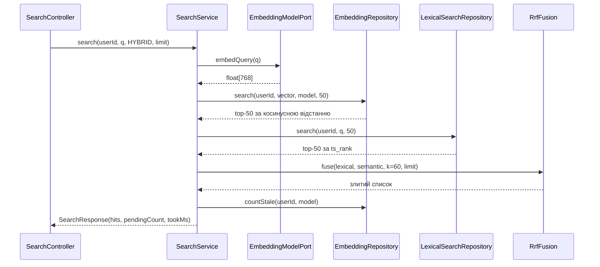
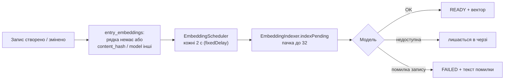

# Пошук

Три режими пошуку по власних записах через один ендпоінт: **лексичний** (слова), **семантичний** (зміст) і
**гібридний** (обидва, злиті через RRF). Режими однаково викликаються з UI і з бенчмарку, тож їх можна чесно
порівнювати.

Код: `backend/.../search/` (`SearchController`, `SearchService`, `RrfFusion`, `repository/LexicalSearchRepository`,
`repository/EmbeddingRepository`, `embedding/EmbeddingIndexer`, `embedding/EmbeddingScheduler`), клієнт:
`frontend/src/pages/SearchPage.tsx`. Теорія — [learning/concepts.md](../learning/concepts.md).

## Ендпоінти

`GET /api/v1/search?q=…&mode=…&limit=…&debug=…`

| Параметр | За замовчуванням | Правила |
|---|---|---|
| `q` | — | обов'язковий, 1–500 символів після `strip()` |
| `mode` | `lexical` | `lexical`, `semantic`, `hybrid` |
| `limit` | `10` | 1–50 |
| `debug` | `false` | для `hybrid` додає до кожного результату `lexicalRank`, `semanticRank`, `rrfScore` |

```json
{
  "mode": "hybrid",
  "query": "біг у парку",
  "tookMs": 241,
  "pendingCount": 0,
  "hits": [
    {
      "id": "5d1a…", "entryDate": "2026-03-14", "title": "Пробіжка",
      "snippet": "Пробіг 5 км у парку біля дому.", "score": 0.0325, "rank": 1,
      "debug": { "lexicalRank": 2, "semanticRank": 1, "rrfScore": 0.0325 }
    }
  ]
}
```

- `score` має різний зміст у кожному режимі (`ts_rank`, косинусна схожість, RRF-бал), тож між режимами його не
  порівнюють — лише `rank`.
- `snippet` — перші 200 символів тексту (`…`, якщо обрізано), однаково для всіх режимів.
- `pendingCount` — скільки записів користувача ще без актуального вектора (лише `semantic` і `hybrid`, інакше
  `null`). Такі записи семантичний пошук поки не бачить.

`POST /api/v1/search/reindex` → 202 `{removed}`: видаляє всі вектори користувача, щоб індексатор порахував їх
заново (після зміни моделі чи префіксів).

## Помилки

| HTTP | `code` | Коли |
|---|---|---|
| 400 | `VALIDATION_ERROR` | порожній або задовгий `q`, невідомий `mode`, `limit` поза 1–50 |
| 503 | `EMBEDDING_UNAVAILABLE` | `semantic` / `hybrid`, а модель ембедінгів не відповідає |

Гібридний режим при недоступній моделі **не** переходить мовчки на лексичний: інакше бенчмарк міряв би не той
режим, а користувач не знав би, що отримав.

## Flow: гібридний пошук



Діаграма для записки: [`diagrams/hybrid-search`](../diagrams/hybrid-search.png).

## Як це працює

### 1. Лексичний пошук (`LexicalSearchRepository`)

Повнотекстовий пошук PostgreSQL через `NamedParameterJdbcTemplate` (результат — рядок із рангом, а не сутність).

- Колонка `search_vector` — `GENERATED ALWAYS AS (to_tsvector('simple', title || ' ' || content)) STORED` з
  індексом GIN (міграція `V4`). PostgreSQL сам перераховує її при кожній зміні запису.
- Конфігурація `simple`: слова лише переводяться в нижній регістр, без стемінгу і стоп-слів. Українського
  стемера в PostgreSQL немає, тож «пробіжка» і «пробіжку» — різні лексеми. Це обмеження свідоме, його міряє
  експеримент (тип запитів `wordform`).
- Оператор задає `pastline.search.lexical-operator`:
  - `and` (за замовчуванням) — `websearch_to_tsquery('simple', :query)`: усі слова запиту; підтримує лапки для
    фрази й `-слово`; не падає на довільному вводі.
  - `or` — запит розбирається тим самим парсером, що будує `search_vector`, лишаються слова від 3 символів, кожне
    проходить через `plainto_tsquery` (воно ж екранує спецсимволи), і вони з'єднуються через `|`. Цей варіант
    додано для абляції в експерименті ([рішення 19–20](../decisions.md#d19)).
- Ранжування: `ts_rank DESC`, потім новіші записи, потім `id` (щоб порядок був детермінований).
- Фільтр `e.user_id = :userId` — у тому самому SQL.

### 2. Семантичний пошук (`EmbeddingRepository.search`)

1. `EmbeddingModelPort.embedQuery(q)` — вектор запиту (768 чисел). Для `embeddinggemma` запит отримує префікс
   `task: search result | query: `, документ — `title: … | text: …` (`EmbeddingPrompts`, з model card моделі).
2. SQL:
   ```sql
   SELECT …, 1 - (x.embedding <=> CAST(:query AS vector)) AS score
   FROM entry_embeddings x JOIN journal_entries e ON e.id = x.entry_id
   WHERE e.user_id = :userId
     AND x.status = 'READY'
     AND x.model = :model
     AND x.content_hash = e.content_hash
   ORDER BY x.embedding <=> CAST(:query AS vector), e.id
   LIMIT :limit
   ```
   `<=>` — косинусна відстань pgvector. Умови на `model` і `content_hash` гарантують, що застарілий вектор
   (текст змінено або модель інша) ніколи не потрапить у видачу.
3. **Без індексу HNSW** — точний пошук. У одного користувача сотні-тисячі записів: повний перебір займає
   мілісекунди і не має похибки наближеного пошуку. HNSW потрібен на мільйонах векторів.

### 3. Гібридний пошук (`RrfFusion`)

Кожен режим дає до 50 кандидатів (`HYBRID_CANDIDATES`). Reciprocal Rank Fusion рахує для кожного запису

```
score = 1 / (k + rank_lexical) + 1 / (k + rank_semantic),   k = 60
```

Якщо запис є лише в одному списку, другий доданок дорівнює 0. RRF працює з **рангами**, тож бали `ts_rank` і
косинусна схожість, що мають різні шкали, не треба нормалізувати. `k = 60` — значення з оригінальної статті
(Cormack et al., 2009), на наборі запитів не підбиралося (`pastline.search.rrf-k`).

При рівному балі вище запис із кращим рангом хоча б в одному списку, далі новіший, далі `id`. `RrfFusion` — чиста
функція без Spring і БД, тож тестується окремо (`RrfFusionTest`).

### 4. Індексація

Вектори рахує фоновий процес, а не запит створення запису: модель може бути повільною або недоступною, а CRUD
від неї не залежить.



- «Черга» — це не окрема таблиця, а SQL-умова (`EmbeddingRepository.findStale`): запис без рядка в
  `entry_embeddings`, або з іншим `content_hash`, або з іншою `model`. Окремого статусу `PENDING` немає.
- `fixedDelay`: наступна пачка стартує лише після завершення попередньої, без накладання.
- Модель недоступна (`EmbeddingUnavailableException`) → пачка лишається на наступний цикл.
- Інша помилка пачки → записи обробляються по одному, щоб один проблемний не блокував решту; невдалий отримує
  `FAILED` з типом помилки (без тексту запису в лозі).
- `saveReady` зберігає вектор разом із хешем тексту, з якого його пораховано. Якщо запис змінили під час
  обчислення, хеші не збігаються, пошук цей вектор пропускає, а індексатор перераховує.
- `FAILED` з тим самим хешем і моделлю не вважається застарілим: зіпсований запис не крутиться в циклі, повтор —
  після редагування тексту або `reindex`.
- Назва моделі містить і варіант префіксів (`embeddinggemma+prompts`): зміна префіксів теж робить вектори
  застарілими.
- У профілі `benchmark` планувальник вимкнено: раннер індексує корпус сам і чекає завершення.

Діаграма: [`diagrams/indexing`](../diagrams/indexing.png).

### 5. Клієнт

Запит, режим і `debug` живуть в адресі (`/search?q=…&mode=hybrid`): той самий URL дає той самий результат, тож
режими зручно порівнювати, перемикаючи лише `mode`. Пошук іде після Enter, а не на кожну літеру. Якщо
`pendingCount > 0`, сторінка попереджає, що частина записів ще не проіндексована.

## Налаштування

| Властивість | За замовчуванням | Що змінює |
|---|---|---|
| `pastline.search.rrf-k` | `60` | `k` у RRF |
| `pastline.search.lexical-operator` | `and` | `and` / `or` для лексичного запиту |
| `pastline.embedding.use-prompts` | `true` | префікси EmbeddingGemma; `false` відтворює умови Лаби 03 |
| `pastline.embedding.worker.enabled` | `true` | фоновий індексатор |
| `pastline.embedding.worker.delay-ms` | `2000` (`3000` у `cloud`) | пауза між пачками |

## Обмеження

- Семантичний пошук завжди повертає найближчі записи, навіть якщо жоден не схожий: порогу схожості немає.
- Немає стемінгу для української в лексичному режимі.
- Розмірність вектора зафіксована в схемі (`vector(768)`): модель з іншою розмірністю потребує нової міграції.
